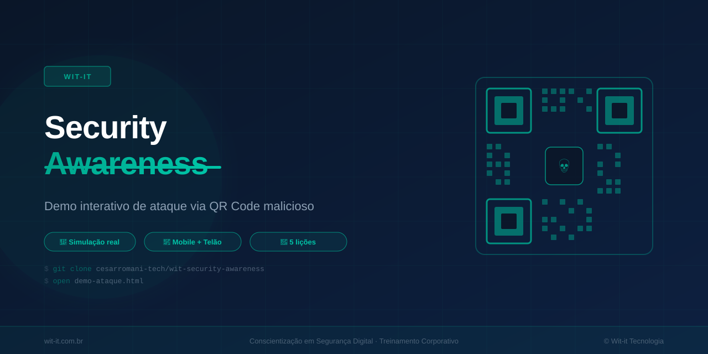

# Security Awareness — Demo de Ataque com QR Code

<p align="center">
  
</p>

> **Treinamento de conscientização em segurança digital para usuários corporativos**  
> Autoria: [Cesar E. S. Romani](https://github.com/cesarromani-tech)

**Versão atual da demo:** `v1.2.2` · [histórico de versões](#-histórico-de-versões)

---

## 📋 Sobre o projeto

Demonstração interativa e animada de uma **cadeia de ataque real via QR Code malicioso**, desenvolvida para apresentações e treinamentos de conscientização em segurança digital (Security Awareness).

A simulação replica, passo a passo, como um usuário desavisado pode ser comprometido ao escanear um QR Code em um evento — desde a isca inicial até a exfiltração de dados e transferência bancária via Pix.

**Nenhum dado real é coletado. Nenhum arquivo é baixado. Nenhuma transferência é realizada.**  
Tudo é simulação visual para fins educativos.

---

## 📁 Arquivos

| Arquivo | Descrição |
|---|---|
| `demo-ataque-v1.2.2.html` | **Versão atual** — simulação passo a passo, com modo de edição da capa |
| `demo-ataque.html` | Versão original (v1.0.0) — sequência automática, mantida para referência |
| `gerador-qrcode.html` | Gerador de QR Code com emoji ou letra no centro |
| `cover.svg` | Imagem de capa do repositório |

---

## 🎬 Fluxo da simulação (`demo-ataque-v1.2.2.html`)

```
[1] Portal de isca       →  Página falsa de "brinde do evento" (capa editável)
[2] Download             →  Barra de progresso + diálogo de permissão
[3] Desktop fake         →  Terminal bash → editor com o script → execução → netcat reverse shell
[4] Comprovante Pix      →  Transferência de R$ 9.539,90 exibida
[5] Revelação educativa  →  5 lições de segurança + fechamento automático
```

A partir do **"Permitir"**, cada etapa roda e **para no final**. A apresentação só segue com um clique (ou toque) na tela, o que permite explicar cada passo ao público antes de continuar.

### Controles

| Ação | Resultado |
|---|---|
| Clique / Toque | Durante uma animação: completa a etapa. Com a etapa concluída: avança para a próxima |
| `Espaço` / `→` | Mesmo comportamento do clique |
| `R` | Reinicia do início |
| `F` | Alterna fullscreen |
| `E` | Abre/fecha o painel de edição da capa (somente na primeira tela) |

> O diálogo de permissão sempre exige resposta (**Permitir** / **Não permitir**); clicar fora dele não avança.

---

## ✏️ Modo de edição da capa

A primeira tela (a "isca") pode ser personalizada para cada evento sem mexer no código. Abra o painel com a tecla **`E`** ou acrescente `?edit` ao endereço (útil no celular), por exemplo `demo-ataque-v1.2.2.html?edit`.

| Grupo | O que dá para alterar |
|---|---|
| **Logo** | Mostrar/ocultar, enviar imagem (PNG, JPG, SVG), tamanho, usar o ícone padrão |
| **Textos** | Nome, título, subtítulo, duas linhas de informação, texto do botão, rodapé, título da aba |
| **Aparência** | Cor de fundo, do texto, do botão e do texto do botão; imagem de fundo com controle de escurecimento |

As alterações aparecem ao vivo e a tela de download herda fundo, cores e textos da capa. A tela final ("Isto foi uma simulação") **não é editável**.

**Como guardar a capa**

- **Automático:** fica salva no navegador, por arquivo.
- **Salvar HTML personalizado:** gera um novo HTML com a capa embutida, para levar a outro computador ou ao evento.
- **Exportar / Importar config (.json):** reaproveita uma capa em outro arquivo.
- **Restaurar padrão:** volta à capa original (fundo verde).

> O arquivo `demo-ataque-v1.2.2.html` acompanha uma capa de exemplo com fundo preto. Use **Restaurar padrão** para voltar ao verde original.

---

## 🔲 Gerador de QR Code (`gerador-qrcode.html`)

Cria QR Codes personalizados com ícone central — ideal para materiais de treinamento e apresentações.

**Recursos:**
- Modo **Emoji** — grade com 32 emojis + campo personalizado
- Modo **Letra/Texto** — até 3 caracteres, 6 fontes, cor customizável
- Controle de tamanho, cor de fundo e arredondamento do ícone central
- Download em PNG com margem

---

## 🚀 Como usar

Não requer servidor, framework ou dependências locais.

```bash
# Clone o repositório
git clone https://github.com/cesarromani-tech/wit-security-awareness.git
cd wit-security-awareness

# Abra diretamente no navegador
open demo-ataque-v1.2.2.html
open gerador-qrcode.html
```

> **Recomendado:** Chrome ou Edge em modo fullscreen (`F11`) para apresentações em telão.

---

## 🎯 Casos de uso

- **Palestras** de conscientização em segurança
- **Treinamentos** corporativos e onboarding de TI
- **Demonstrações** para equipes de SOC e suporte
- **Eventos** de tecnologia e cibersegurança
- **Campanhas internas** de phishing simulado

---

## 🔐 Lições abordadas na simulação

1. **Desconfie** — a maioria dos ataques explora a confiança, não a tecnologia
2. **QR Code esconde a URL real** — você não sabe para onde vai antes de escanear
3. **Promoção legítima nunca pede instalação** — validadores e cupons executáveis são red flags
4. **Pressa é a ferramenta do golpe** — contadores regressivos existem para impedir o raciocínio
5. **Acesso remoto começa em silêncio** — quando o usuário percebe, os dados já foram

---

## ⚙️ Stack técnica

- HTML5 + CSS3 + JavaScript vanilla (zero dependências externas na demo)
- [`qrcodejs`](https://cdnjs.cloudflare.com/ajax/libs/qrcodejs/1.0.0/qrcode.min.js) via CDN (apenas no gerador)
- Responsivo: mobile-first, adaptável a qualquer tela (celular → telão 4K)
- Safe-area support (`env(safe-area-inset-*)`) para dispositivos com notch
- `clamp()` para tipografia fluida
- Engine de animação própria com controle de geração, skip, abort e pausa entre etapas

---

## 🗂️ Histórico de versões

| Versão | Mudanças |
|---|---|
| **1.2.2** | Autoria (Cesar E. S. Romani) no cabeçalho do arquivo, em `<meta name="author">` e no crédito da tela final |
| **1.2.1** | Correção da última tela: ocupa toda a viewport, conteúdo centralizado sem cortar o topo e com rolagem quando necessário; texto estático do Pix sem nome de banco real |
| **1.2.0** | Modo de edição da capa (tecla `E` / `?edit`): logo, imagem de fundo, textos e cores; salva no navegador; exporta HTML personalizado e config `.json` |
| **1.1.0** | Fluxo passo a passo após "Permitir" (cada etapa pausa e avança com clique/toque); diálogo de permissão sempre exige resposta |
| **1.0.0** | Versão original — sequência automática com clique para pular (`demo-ataque.html`) |

---

## 📄 Licença

Este projeto é disponibilizado para uso educacional e treinamentos internos.  
Proibida a utilização para fins maliciosos ou enganosos.

---

<div align="center">

Autoria: [Cesar E. S. Romani](https://github.com/cesarromani-tech) · [@cesarromani-tech](https://github.com/cesarromani-tech)

</div>
